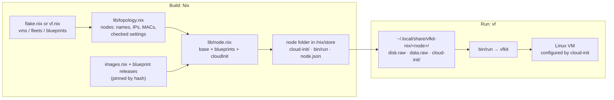
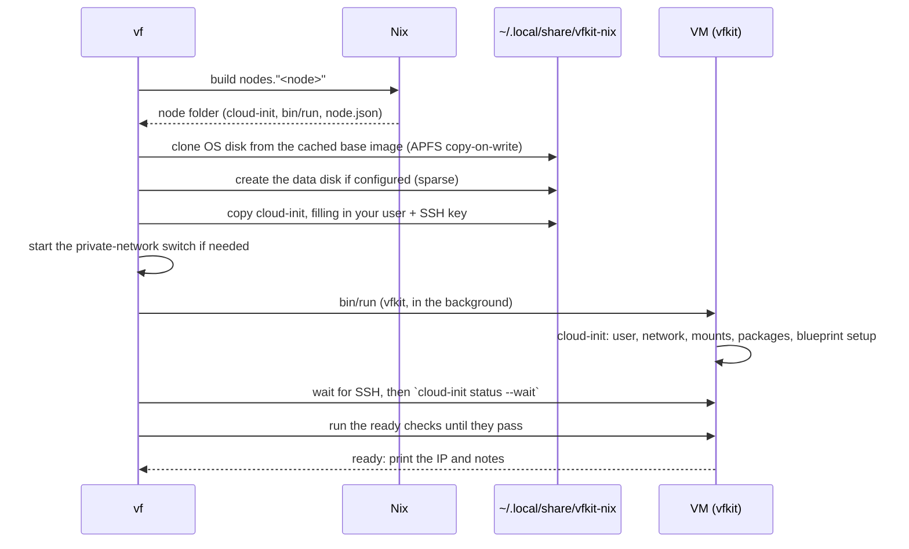
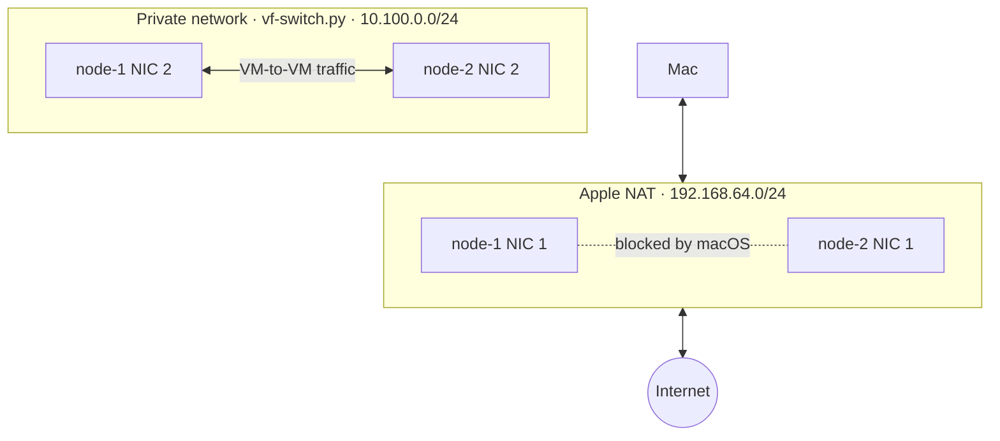

# How it works

There are two phases. **Build** is pure Nix: your project becomes one folder of plain files per
node. **Run** is `vf`: it copies those files into a state folder and starts vfkit.



- **Schema:** [`lib/options.nix`](../lib/options.nix) declares `vms`, `fleets` and their node
  options with the NixOS module system, so wrong types fail with the option's path.
- **Topology:** [`lib/topology.nix`](../lib/topology.nix) expands fleets and roles into a flat list
  of nodes, assigns names, IPs and MAC addresses (derived from the name, so they're stable), and
  resolves each node's blueprint settings: blueprint defaults, then fleet values, then role values,
  rejecting unknown keys and wrong types.
- **Per-node folder:** [`lib/node.nix`](../lib/node.nix) calls each blueprint's `config` with the
  node and its fleet, merges the results with the base config (your user, SSH key, disks, mounts,
  `/etc/hosts`) and the node's `cloudInit`, and writes:
  - `cloud-init/user-data`, `meta-data`, `network-config`
  - `bin/run`: the exact vfkit command line
  - `node.json`: what `vf` needs at runtime (image, disk sizes, mount sources, ready checks, notes)
- **Runtime:** [`scripts/vf.py`](../scripts/vf.py) is one Python file using only the standard
  library. It reads `vfInfo` (all nodes, for `list` and IPs) with `nix eval`, and builds node folders
  with `nix build`.

The guest user and SSH key are placeholders in the store (`@VF_USER@`, `@VF_SSH_PUBKEY@`). `vf`
fills them in when it copies the cloud-init files, so the store holds nothing user-specific. The
cloud-init `instance-id` is a hash of the generated config, which is why a `rebuild` re-runs
cloud-init and a plain restart doesn't.

## What `vf <node> up` does



`vf @<fleet> up` builds every node of the fleet in one `nix build`, then runs `up` for all of them
in parallel and prefixes each line with the node's name.

## Networking



| | Network | Reaches | Configured by |
|---|---|---|---|
| NIC 1 (always) | Apple NAT, `192.168.64.0/24` | The internet and the Mac, **not other VMs** | DHCP, or `ip` / `ipStart` |
| NIC 2 (with a private network) | User-mode switch ([`scripts/vf-switch.py`](../scripts/vf-switch.py)) | Other VMs on the same network name | `private.ip` / `private.ipStart` |

- **Why two NICs:** macOS marks every VM's port on its NAT bridge as private, so VMs can't reach
  each other there. A shared bridged network would need root on every VM start.
- **The private network without root:** vfkit can back a NIC with a Unix datagram socket, one
  Ethernet frame per datagram. `vf-switch.py` (about 60 lines, running as you) learns which socket
  each MAC address is behind and forwards frames like a basic hardware switch. One switch runs per
  network name, started on demand by `vf up` and stopped with `vf net stop <name>`. Throughput was
  about 2.8 Gbit/s in testing. The Mac's own networking isn't touched, so the Mac can't reach this
  network.
- **MTU 1280 on NAT:** full-size packets through macOS NAT can be dropped silently, depending on the
  Mac's uplink. When that happens, IPv4 TLS stalls (`apt` hangs) while `ping` and plain HTTP work.
  1280 is the IPv6 minimum and works everywhere.
- **SSH uses `/usr/bin/ssh`** with a key in `~/.local/share/vfkit-nix/`. macOS's Local Network
  privacy check can block non-Apple binaries from reaching VM IPs, which Apple's own ssh avoids.
- **DHCP IPs** are looked up in `/var/db/dhcpd_leases` by MAC address. A DHCP node may get a new
  address after `rebuild`; use static IPs (`ip` / `ipStart`) when that matters.

## Where things live

| What | Where | Size | |
|---|---|---|---|
| Pinned images (qcow2) | `/nix/store` | Debian 320 MB, Fedora 504 MB | Fetched on first use |
| Blueprint releases | `/nix/store` | OpenSearch 1.0 GB, k3s 71 MB, etcd 55 MB | Shared read-only into nodes at `/opt/vf/<name>`, never copied |
| `vf` and its tools, vfkit | `/nix/store` | ~165 MiB + ~20 MB | |
| Generated node folders | `/nix/store` | KBs | |
| Raw base images | `~/.local/share/vfkit-nix/images/` | ~3 GB apparent per OS | Converted once from the pinned qcow2 |
| VM disks, logs | `~/.local/share/vfkit-nix/<node>/` | Only what the VM changed | `disk.raw` (APFS clone of the base), `data.raw` (sparse), `vfkit.log`, `console.log` |
| Private networks | `~/.local/share/vfkit-nix/net/` | | Switch sockets, PIDs and logs |

- **Why a raw base outside the store:** vfkit only boots raw disks, and APFS clones only work within
  one volume. `/nix` is a separate volume, so `vf` converts each image once next to the VM disks,
  and every VM disk is an instant copy-on-write clone of it.
- **What that costs:** a 3-node OpenSearch fleet with data disks took 148 MiB on top of the shared
  base. `du` shows each `disk.raw` at full size because it can't see shared blocks.
- **Garbage collection:** vfkit-nix creates no GC roots. `nix store gc` (after stopping VMs, since
  running nodes read releases from the store) frees releases and images; the next `up` fetches them
  again.

## Pinning

Images and releases use `fetchurl` / `fetchzip` with a content hash. Nix downloads each file once,
checks it, and reuses the stored copy afterwards without contacting the URL again.

If the bytes at a URL change, the build fails before any VM boots with
`hash mismatch … specified: … got: …`. That's on purpose: a different image arriving silently would
make VMs non-reproducible. The realistic failure is a URL disappearing; Debian removes dated images
after some months. To update an image, change the URL in [`images.nix`](../images.nix) and run
`nix store prefetch-file <url>` for the hash.

## Why Nix, and where it stops

Nix earns its place in five ways:

1. **Pinning.** Images, releases and tools are fixed by hash. The same config gives the same bytes
   on any Mac.
2. **Download once, share everywhere.** Releases are fetched once and shared read-only into every
   node, so a 3-node etcd cluster is ready in about 10 seconds and rebuilds download nothing.
3. **A real language for topology.** IPs, MACs, peer lists and fleet → role overrides are computed
   and type-checked before boot. An earlier prototype used YAML merging and templating inside the
   guest, where a dropped newline silently broke an etcd config.
4. **Inspectable output.** Every node is a folder you can read, diff, or run by hand.
5. **Sharing and extending.** Blueprints are plain functions, the framework is a flake input locked
   by `flake.lock`, and `vf` comes with all its dependencies.

Nix doesn't manage anything at runtime: processes, disks and waiting are `vf.py`. The cost is about
1–2 seconds of evaluation per `vf` call.

## Repository layout

```
flake.nix               the vf package, lib.mkProject, templates; this repo's own project is examples/
lib/default.nix         mkProject: project -> flake outputs
lib/options.nix         schema for vms, fleets and roles
lib/topology.nix        vms/fleets -> nodes (names, IPs, MACs, settings)
lib/node.nix            one node -> cloud-init files, bin/run, node.json
lib/util.nix            cloud-config merge, IP math, MAC derivation
blueprints/             built-in blueprints, one file each
images.nix              pinned Debian and Fedora cloud images
scripts/vf.py           the lifecycle CLI
scripts/vf-switch.py    user-mode Ethernet switch for private networks
examples/               this repo's example project
templates/              `nix flake init -t` templates
docs/                   this guide and the blueprint guide
```
